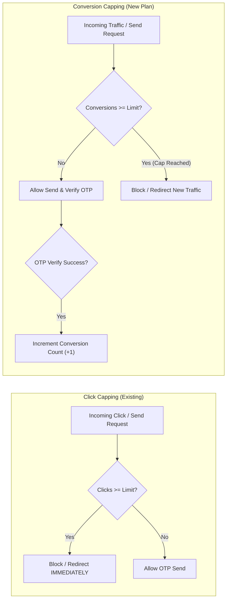
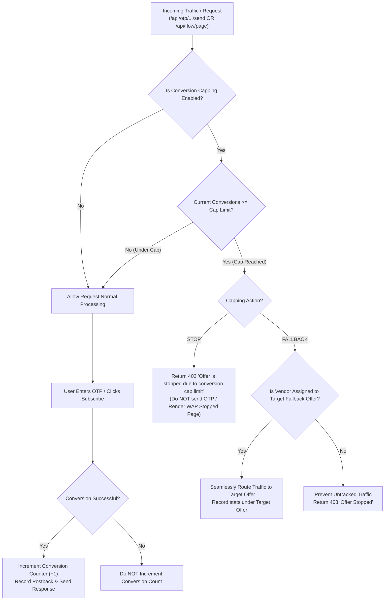

# Conversion Capping & Traffic Fallback Implementation Plan

## 1. Executive Summary & Overview

Abhi tak system me **Click Capping** implement tha (jo incoming requests / clicks `/send` par trigger hota tha).
Yeh plan **Conversion Capping** (Lead / Subscriber Cap) ko implement karne ke liye hai.

### Core Difference: Click Cap vs Conversion Cap



---

## 2. Business Logic & Flow

### 2.1 Conversion Definition Across Flows

Ek conversion tab register hogi jab user successfully verified ya subscribed status par pahuchega:

| Flow Type | Conversion Event | Status / Trigger Point | File Reference |
| :--- | :--- | :--- | :--- |
| **API Expose (OTP)** | Successful OTP Verification | `verifyResult.success === true` & `visitStatus = SUCCESS` | [otp.service.js](file:///d:/dddd/backend/src/modules/otp/otp.service.js) |
| **API Expose (DCB)** | Successful DCB PIN Confirm | Entitlement active & `visitStatus = SUBSCRIBED` | [universe-dcb-expose.service.js](file:///d:/dddd/backend/src/modules/flow/universe-dcb-expose.service.js) |
| **WAP Funnel (OTP)** | Confirm Page OTP Success | `transition-confirm-otp.js` -> `SUBSCRIBED` | [transition-confirm-otp.js](file:///d:/dddd/backend/src/modules/flow/helpers/transition-confirm-otp.js) |
| **WAP Funnel (DCB/HE)** | Subscription Completed | `transition-confirm.js` -> `SUBSCRIBED` | [transition-confirm.js](file:///d:/dddd/backend/src/modules/flow/helpers/transition-confirm.js) |

---

### 2.2 Conversion Cap Decision Flow



> [!NOTE]
> **In-flight OTPs Policy:**
> Jab Conversion Cap reach ho jata hai, tab **nayi incoming requests (`/send`) block ya redirect** ho jati hain. Lekin agar kisi user ne cap reach hone se pehle valid OTP generate kar liya tha, toh uska OTP verify allow hoga taaki user experience break na ho.

---

## 3. Database & Schema Design

### 3.1 Migration: Add `capping_metric`
Table: `campaigns`

| Column Name | Data Type | Default | Options / Description |
| :--- | :--- | :--- | :--- |
| `capping_metric` | `varchar(16)` | `'conversions'` | `'conversions'` (Default) \| `'clicks'` |
| `capping_enabled` | `boolean` | `false` | Enable / Disable capping |
| `capping_limit` | `int` | `null` | Threshold limit (e.g. 5 conversions) |
| `capping_action` | `varchar(16)` | `'stop'` | `'stop'` \| `'fallback'` |
| `fallback_campaign_id`| `int` | `null` | Target Campaign ID |
| `capping_interval` | `varchar(16)` | `'daily'` | `'daily'` \| `'weekly'` \| `'monthly'` \| `'total'` (IST) |

> [!TIP]
> `capping_metric` option dene se user future me kisi campaign par **Click Cap** aur kisi par **Conversion Cap** choose kar sakta hai.

---

## 4. Backend Implementation Details

### 4.1 Redis Key Architecture & Counters
Redis service me do distinct keys manage hongi:

* **Conversion Counter Key:**
  - Daily: `capping:conv:{campaignId}:daily:{YYYY-MM-DD}` (IST Date)
  - Weekly: `capping:conv:{campaignId}:weekly:{Monday-YYYY-MM-DD}` (IST Date)
  - Monthly: `capping:conv:{campaignId}:monthly:{YYYY-MM}` (IST Month)
  - Total: `capping:conv:{campaignId}:total`
* **TTL:** Same existing IST TTL (1 day, 14 days, 60 days, 365 days).

### 4.2 Capping Service Updates: [capping.service.js](file:///d:/dddd/backend/src/modules/campaigns/capping.service.js)

1. **`getCampaignConversionCount(campaignId, interval)`:**
   - Pehle Redis key check karega.
   - Cache miss hone par database fallback:
     ```sql
     SELECT COUNT(*) FROM visits 
     WHERE campaign_id = :campaignId 
       AND (visit_status IN ('SUCCESS', 'SUBSCRIBED', 'OTP_VERIFIED') OR otp_verified_at IS NOT NULL)
       AND created_at >= :periodStart;
     ```
2. **`incrementCampaignConversionCount(campaignId, interval)`:**
   - Atomic `redisService.incr(conversionKey, ttl)`.
3. **`evaluateCapping(campaign, options)`:**
   - Campaign ka `cappingMetric` check karega (`'conversions'` vs `'clicks'`).
   - Agar `'conversions'` hai -> `getCampaignConversionCount` evaluate karega.
   - Agar limit reach ho chuki hai -> Action (`stop` ya `fallback`) return karega.

### 4.3 Trigger Points in Controllers & Services

1. **Gate Check (Before Sending OTP / Serving Page):**
   - [otp.service.js](file:///d:/dddd/backend/src/modules/otp/otp.service.js) (`exposeSendOtp`): Capping evaluate karega. Agar conversion limit full hai, toh `/send` par hi 403 Stop ya Fallback redirect karega.
   - [get-page.js](file:///d:/dddd/backend/src/modules/flow/helpers/get-page.js) (WAP): Capping evaluate karke page block ya redirect karega.
2. **Increment Trigger (On Successful Conversion):**
   - [otp.service.js](file:///d:/dddd/backend/src/modules/otp/otp.service.js) (`exposeVerifyOtp`):
     ```javascript
     if (verifyResult?.success && !held) {
       await cappingService.incrementCampaignConversionCount(
         cId,
         campaign.cappingInterval,
       );
     }
     ```
   - [transition-confirm-otp.js](file:///d:/dddd/backend/src/modules/flow/helpers/transition-confirm-otp.js) & [transition-confirm.js](file:///d:/dddd/backend/src/modules/flow/helpers/transition-confirm.js):
     Jab user successfully `SUBSCRIBED` mark hota hai, tab increment call hoga.

---

## 5. Frontend UI Modal Updates

File: [CampaignCappingModal.jsx](file:///d:/dddd/frontend/src/components/dashboard/CampaignCappingModal.jsx)

### New Controls in Modal:
1. **Capping Metric Selector (Radio Buttons or Segmented Control):**
   - 🔘 **Conversion Cap (Recommended):** Cap triggers when successful subscribers/conversions reach limit.
   - 🔘 **Click Cap:** Cap triggers when incoming clicks/requests reach limit.
2. **Dynamic Labels & Help Text:**
   - Metric = `Conversion`: Label reads **"Conversion Cap Limit"** (*"Maximum number of successful subscriptions before offer stops/redirects"*).
   - Metric = `Click`: Label reads **"Click Cap Limit"** (*"Maximum number of incoming requests before offer stops/redirects"*).
3. **Reset Intervals Display:**
   - Daily (Resets every day at 00:00 IST)
   - Weekly (Resets every Monday at 00:00 IST)
   - Monthly (Resets 1st of every month at 00:00 IST)
   - Total / Lifetime

---

## 6. Verification & Test Plan

| Test Case | Scenario | Expected Outcome |
| :--- | :--- | :--- |
| **TC-1: Under Cap** | Conversion Limit = 2. 5 clicks aaye, 1 OTP verify hua (1 conversion). | Next click/send request ALLOWED (200 OK). Traffic stops nahi hoga. |
| **TC-2: Cap Reached (Stop)** | Conversion Limit = 2. 2nd OTP verify hua (2 conversions done). Next user hits `/send`. | HTTP 403: `"Offer is stopped due to capping limit"`. OTP generate nahi hoga. |
| **TC-3: Cap Reached (Fallback)** | Conversion Limit = 2. 2 conversions complete. Target Offer = #33. Next user hits `/send`. | Request smoothly Target Offer #33 par redirect hogi. Offer #21 conversions = 2 freeze rahega. |
| **TC-4: Unmapped Vendor** | Target Offer par Vendor mapped nahi hai. | Redirect abort hoke 403 Stop message aayega. |
| **TC-5: IST Reset** | Raat 00:00 IST par date change hoti hai. | Conversion count `0` ho jayega aur offer fir se open ho jayega. |

---

## 7. Next Steps & Execution Milestones

1. **Step 1:** Migration run karke `campaigns.capping_metric` column add karein.
2. **Step 2:** `capping.service.js` me `getCampaignConversionCount` aur `incrementCampaignConversionCount` add karein.
3. **Step 3:** `otp.service.js` aur WAP confirm handlers me successful verify/subscribe par increment trigger lagayein.
4. **Step 4:** [CampaignCappingModal.jsx](file:///d:/dddd/frontend/src/components/dashboard/CampaignCappingModal.jsx) me Metric Switcher (Conversions vs Clicks) add karein.
5. **Step 5:** End-to-end verification run karein (Send -> Verify -> Counter -> Fallback).
